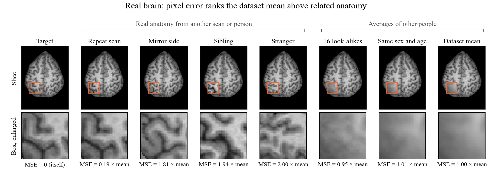
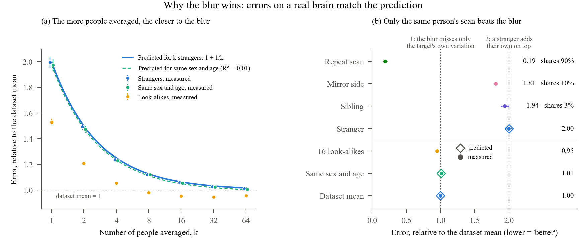
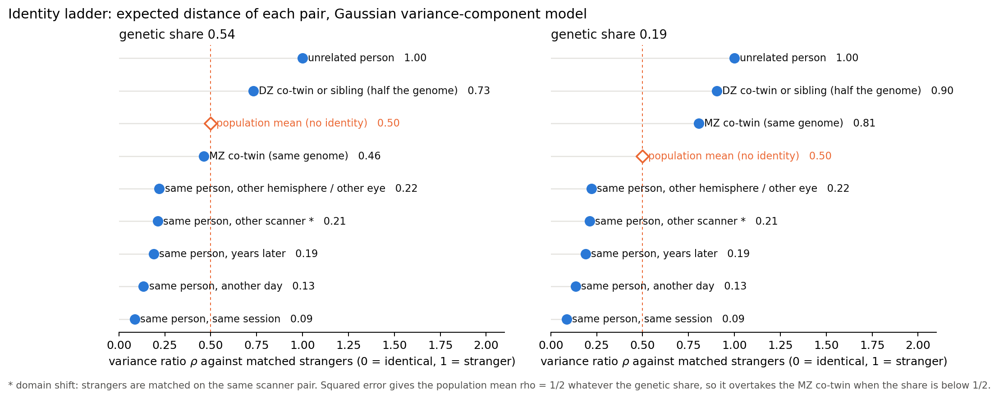

# Identity ladder metric

[](LICENSE)
[](LICENSE-CC-BY-4.0)
[](https://www.python.org/)
[](https://github.com/BraTS-inpainting/inpainting)
[-success.svg)](https://openneuro.org/datasets/ds004169)
[](docs/HANDOFF.md)

How much of a person is left in a synthesized brain image?

BraTS inpainting and most image synthesis work score a fill with RMSE, PSNR and SSIM against the true image. These
numbers say how close the voxels are. They do not say whether the fill still looks like *this* brain, or like any
plausible brain. This repository shows where these metrics fail and builds a calibrated score for that question.



*An inpainting model has to fill a missing piece of a brain scan (the orange box), and it is usually graded by pixel
error (MSE): how far the filled voxels are from the true ones. Here no model is involved. The box of one brain is
filled by hand from different sources, ordered from the most related to the least, and each fill is graded with the
same pixel error. If the metric rewarded "looks like this brain", the error would grow from left to right. It does
not. **Target**: the true tissue. **Repeat scan**: the same person, scanned again. **Mirror side**: the person's
other hemisphere, mirrored onto this side. **Sibling**: a brother or sister, real tissue that shares about half of
the genes. **Stranger**: one unrelated person. **16 look-alikes**: the average of the 16 unrelated people whose
tissue around the box looks most like the target's. **Same sex and age**: the average of the unrelated people of the
same sex and an age within 2 years (median 51 people); it asks whether sex and age tell you what the brain looks like
here. **Dataset mean**: the average of all unrelated participants (median 191 people), the "typical brain". All
brains are aligned to one template first and the averages are taken voxel by voxel; they come out as a smooth blur
because the sulci of different people sit in different places and cancel. "MSE = 1.94 × mean" means the fill's pixel
error is 1.94 times that of the dataset mean (lower is "better" for the metric), averaged over the 192 people whose
box lies inside the brain; the brain shown is one of them. One stranger has twice the error of the dataset mean
(2.00), as the theory below predicts. The sibling (1.94) and the mirror side (1.81) are real, related, folded tissue,
yet score almost as badly as a stranger and far worse than the blur. Only the repeat scan (0.19) clearly beats it.
The same-sex-and-age average (1.01) is no better than the dataset mean: sex and age explain about 1% of the variance
in this box (R² = 0.01), partly because QTIM ages span only 20 to 29 years; the small excess over 1 is the price of
averaging fewer people. The 16 look-alikes (0.95) beat the blur only slightly. So a model that outputs the blur
scores better on RMSE, PSNR and SSIM than one that draws plausible, individual sulci. Data: QTIM (OpenNeuro
ds004169, CC0), session-1 scans; axial slice at z = 55 mm, subject's left on the left; frozen parietal box x -45 to
-13, y -65 to -33, z 43 to 67 mm in MNI space. Affine registration to MNI 2009a symmetric only, before registration
QC. The brain shown is chosen mechanically: the first in participant order whose box is valid in their own scan, a
sibling's and a repeat scan. Generated by `paper/isbi2027/make_fig_real_case.py`.*



*Why 1 and 2. Every brain differs from the dataset mean by its own individual part; call its size V. A fill made
from the dataset mean misses exactly that part of the target, so its error is V: this is the unit, 1. A fill made
from one stranger misses the target's individual part and adds the stranger's own, which is unrelated, so the two
sizes add up: V + V = 2. Neither number is fitted to the data; both follow from this decomposition before any brain
is measured. (a) Averaging k strangers keeps the target's V but shrinks their added part to V/k, so the error is
predicted to fall as 1 + 1/k (blue line). The measured averages (blue dots, 95% intervals) sit on it, from 2.00 for
one stranger to 1.01 for 64. If sex and age carried part of the individual pattern, a share R², the same-sex-and-age
averages (green) would sit lower by that share; measured, R² = 0.01, so the green and blue curves almost coincide.
The look-alikes (orange) have no curve because they are not random donors: they are picked for tissue around the box
that resembles the target's, so they share part of its individual pattern, and that part shrinks as more of them
are taken (the 1st is the closest match, the 64th a poor one). Their error therefore falls faster than 1 + 1/k at
first, then levels off just below 1 (0.95 at 16). (b) Every column of the figure above. Open diamonds: the
prediction, where it needs no measured input. For a related donor the error is 2 minus twice the share of the
individual part they have in common with the target; the share on the right is read back from the measured error.
The repeat scan shares 90%, the mirror side 10% and the sibling 3%: in this box the folding of a sibling, or of the
other hemisphere, is almost as unrelated as a stranger's, so they score near 2 while the blur scores 1. Generated
by `paper/isbi2027/make_fig_real_case.py`.*

Status: research code, work in progress (Kate Kondrateva, Hertie Institute for AI in Brain Health, Tübingen).
Nothing here is a validated clinical or biometric measure.

---

## Why: pixel error rewards the mean

**What the challenge itself reports.** In the 2023 BraTS inpainting overview [1], the ranking by SSIM, RMSE and PSNR
was clear. The top team (Ying-Weng et al.: SSIM 0.91, RMSE 0.07, PSNR 23.59) won. The authors note that apart from
one 2D diffusion model, which had stripe artefacts in the sagittal and coronal views, the methods "produce blurry
inpaintings across all three views". Looking at the images "painted a more faceted picture" than the ranking. They
call for synthesis metrics that agree better with expert perception. The 2025 winner is again a U-Net trained to
inpaint masked regions (SSIM 0.919, PSNR 26.93, RMSE 0.052 on the final test set) [2].

**What the downstream check showed.** The organisers expected that a downstream U-Net segmentation of the inpainted
brains would expose the blurry fills. It did the opposite: the segmentation of the blurred fills came *closer* to the
oracle segmentation of the real image.

**Why both happen. It is arithmetic, not a bug in the models.** Write the tissue as $x = \mu + \delta$: $\mu$ is the
population average, $\delta$ everything individual (genes, development, side, session, noise), with variance $V$ per
voxel, and $h^2$ the genetic share of $V$. The expected squared error of a fill is then:

| Fill | Error against the truth | Expected squared error |
|---|---|---|
| population mean $\mu$ | $\delta$ | $V$ |
| stranger's tissue | $\delta - \delta'$ (independent) | $2V$ |
| DZ co-twin's or sibling's tissue | half of the genetic part is shared | $2V - h^2 V$ |
| MZ co-twin's tissue | non-shared part only | $2V(1 - h^2)$ |

So the mean always has half the error of a real stranger's tissue. It beats a sibling always and an MZ co-twin whenever
$h^2 < 1/2$. Squared error is minimised exactly at the conditional mean, so a network trained or selected on MSE, RMSE
or PSNR is pushed towards blur by the metric itself. SSIM does the same in homogeneous regions through its
stabilising constant $C_2$. An average of $k$ people whose shared factor explains a share $R^2$ of $V$ has error
$(1 - R^2)(1 + 1/k)\,V$; one same-person donor with correlation $r$ has $2(1 - r)\,V$.



*Expected distance of each pair under the Gaussian variance-component model, as a ratio to matched strangers. Left:
genetic share 0.54, the MZ co-twin is closer than the mean. Right: genetic share 0.19, the mean overtakes the MZ
co-twin. Generated by `src/ladder_diagram.py`.*

Segmentation is a pointwise score too. Dice and voxel accuracy against the oracle count voxel matches, and when a fill
carries no individual anatomy, the best guess for each voxel is the most typical label: the mode instead of the mean.
A downstream check with a pointwise metric does not remove the bias. It inherits it.

**What would break it.**

- Treat the population mean as the floor, not the stranger. A fill means something only if it beats the mean, so
  report its distance from the mean next to its distance from the truth.
- Score the shape and topology of the segmentation instead of overlap. Blur simplifies folding.
- Calibrate on the identity ladder: repeat scan, co-twin and stranger donor fills next to the mean.
- Check realism at the population level: can the fill be told apart from real tissue at all?

A useful distance should keep the order of the ladder. We express every distance on one scale:

$$c(d) = P\left(d_{\text{stranger}} > d\right)$$

where strangers are unrelated pairs taken under the *same* nuisance condition (same scanner and protocol). $c = 0.5$
is a typical stranger, $c = 1$ is closer than every stranger. The mean $c$ over a rung is the AUC of that rung
against strangers.

[1] Kofler F, Meissen F, Steinbauer F, Graf R, Ehrlich SK, Reinke A, et al. The Brain Tumor Segmentation (BraTS)
Challenge: Local Synthesis of Healthy Brain Tissue via Inpainting. arXiv:2305.08992v3, 2024.
https://arxiv.org/abs/2305.08992

[2] Zhang J, Weng Y, Chen K. Robust 3D Brain MRI Inpainting with Random Masking Augmentation. arXiv:2511.20202, 2025.
https://arxiv.org/abs/2511.20202

---

## Repository layout

```
src/              experiment code, one script per experiment
tests/            pytest suite
results/          JSON/CSV outputs, reports, figures/
docs/             protocols, research plan, hand-over notes
paper/            papers built on this project, each folder self-contained with its own README
```

Key scripts for the brain results:

| Script | What it does |
|---|---|
| `src/real_cases.py` | QTIM preparation: N4, skull stripping, affine registration to MNI 2009a symmetric |
| `src/donor_ladder_brain.py` | the donor ladder on QTIM: k-donor fills by cohort, error relative to the dataset mean |
| `src/donor_ladder_robustness.py` | the same ladder under other seeds, boxes and registration (SyN) |
| `paper/isbi2027/make_fig_real_case.py` | the figure above |
| `src/ladder_diagram.py`, `src/toy_ladder.py` | the Gaussian model of the ladder and its closed form |
| `src/brats_panel_checks.py` | behaviour of the official BraTS metric code |

## Running

Python 3.11. Versions used for the saved results: numpy 1.26.4, scipy 1.15.3, scikit-image 0.26.0, torch 2.10.0,
torchmetrics 1.9.0, `inpainting` 0.0.12 (official BraTS metric package), matplotlib 3.10.8, nibabel 5.4.2,
antspyx 0.6.3, SimpleITK 2.5.3.

```bash
python -m pytest tests/ -q
```

```bash
python src/donor_ladder_brain.py
```

```bash
python paper/isbi2027/make_fig_real_case.py
```

The brain scripts expect the prepared QTIM scans in the shared data root (`C:\Projects\data`).

## Data

QTIM (OpenNeuro ds004169, CC0): T1-weighted scans of young adult twins and siblings, aged 20 to 29. Prepared scans,
per-person tables and patch caches stay outside this repository, in a local private data folder. The repository holds
code, aggregate results and the figure above, whose crops come from CC0 data and carry no IDs.

## Limits

- One dataset of young adults; one registration (affine, before registration visual QC).
- The figure shows one person; the numbers under it are averages over 192 people for one box.
- A robustness re-check over seeds, box sizes and SyN registration is under way
  ([`docs/PROTOCOL_donor_ladder_robustness.md`](docs/PROTOCOL_donor_ladder_robustness.md)).

## Related documents

- [`docs/PROTOCOL_donor_ladder_brain.md`](docs/PROTOCOL_donor_ladder_brain.md): the brain donor ladder
- [`docs/Research_Plan_Identity_Ladder_Metric.md`](docs/Research_Plan_Identity_Ladder_Metric.md): hypotheses
- [`docs/HANDOFF.md`](docs/HANDOFF.md): current state and next steps

## License

Code: MIT ([`LICENSE`](LICENSE)). Text, figures and results: CC BY 4.0 ([`LICENSE-CC-BY-4.0`](LICENSE-CC-BY-4.0)).
Third-party datasets keep their own terms; the only images from them are the QTIM crops in
`results/figures/fig_real_case_parietal.png` (CC0).
