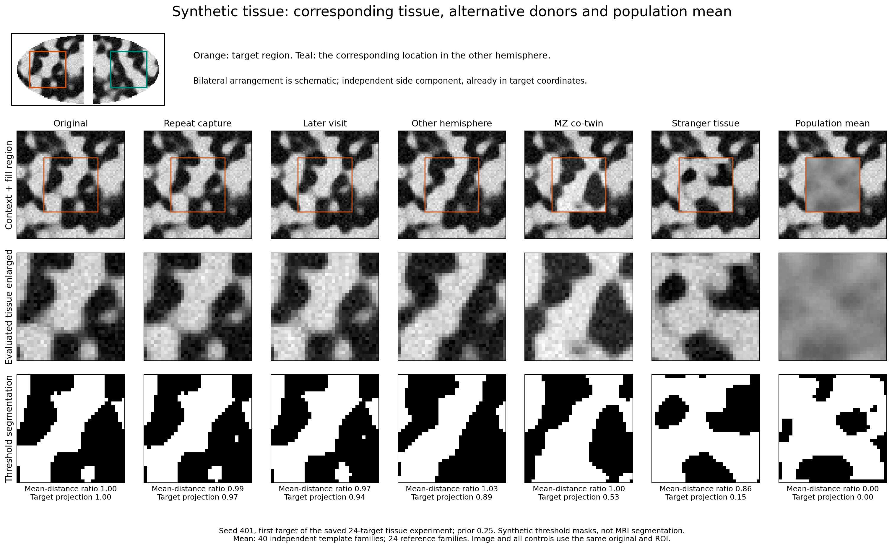
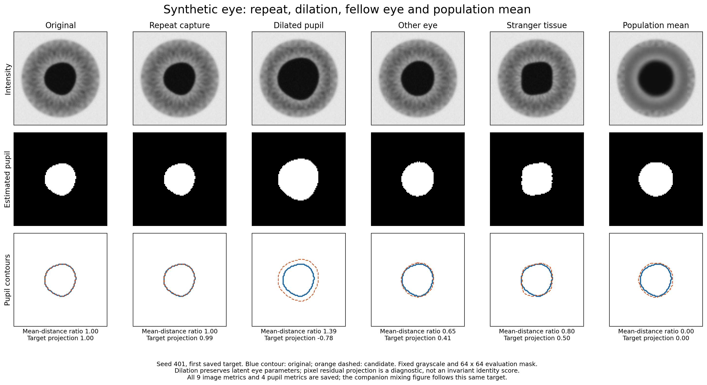
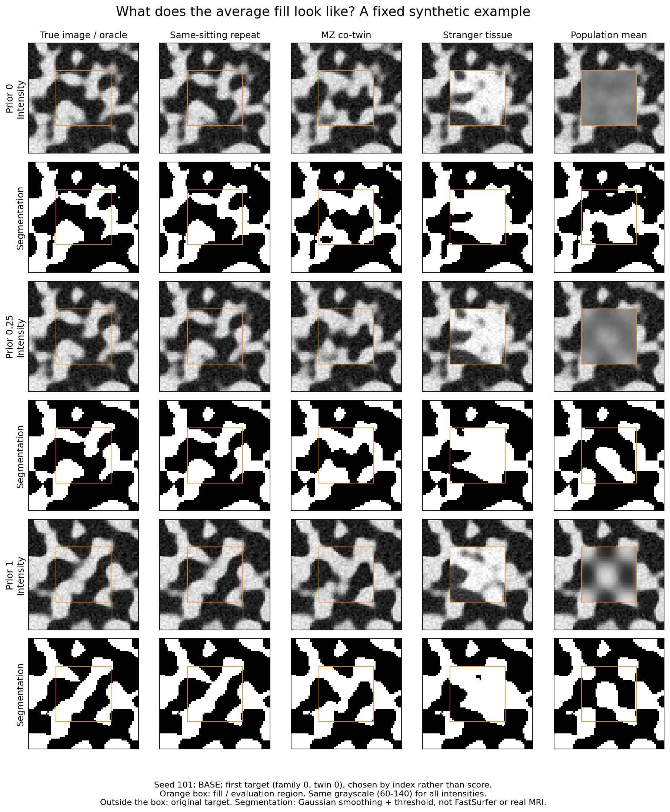
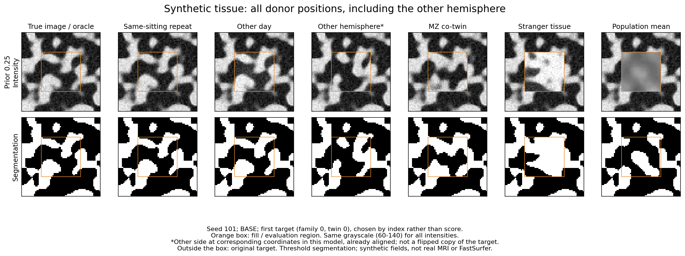
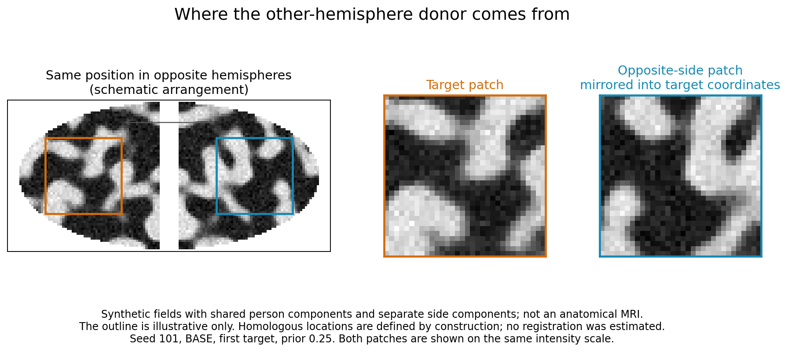
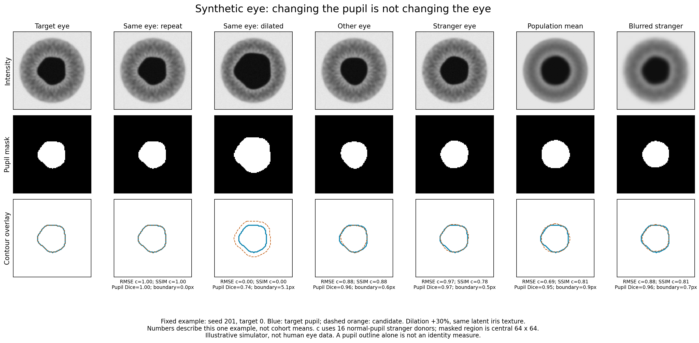
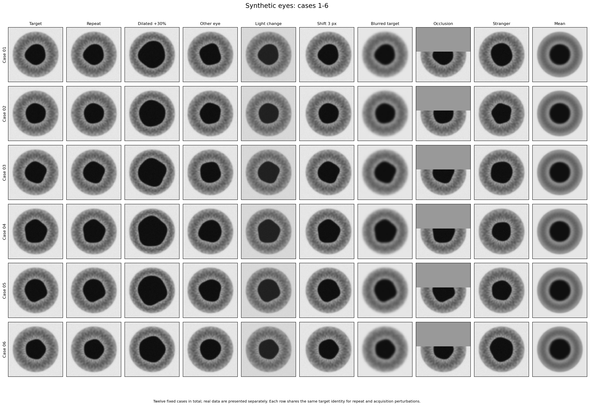
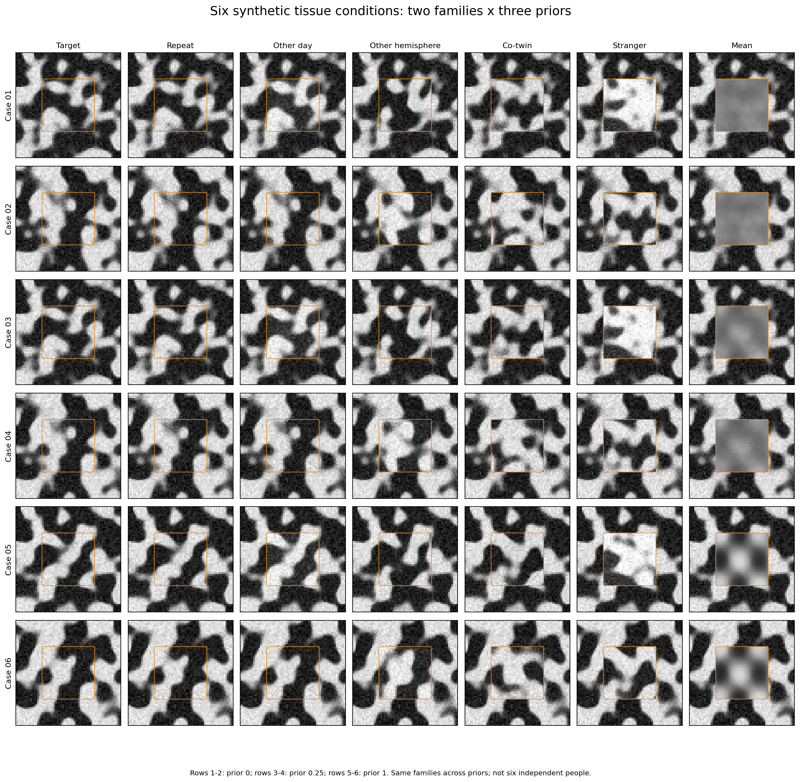

# Identity ladder metric

How much of a person is left in a synthesized image?

BraTS inpainting and most image synthesis work score a fill with RMSE, PSNR and SSIM against the true image. These
numbers say how close the pixels are. They do not say whether the fill still looks like *this* brain, or like any
plausible brain. This repository builds a calibrated score for that question and tests where the standard metrics
fail.

The idea is a ladder of pairs with known amounts of shared identity:

| Rung | Pair | What differs |
|---|---|---|
| L0 | same person, same session | acquisition noise |
| L1 | same person, other scanner or protocol | + scanner |
| L2 | same person, years later | + ageing |
| L3a / L3b | MZ / DZ co-twin | + part of the genome, individual development |
| L4 | unrelated person | everything |

A useful distance should keep this order. We express every distance on one scale:

**c(d) = P(d_stranger > d)**, where strangers are unrelated pairs taken under the *same* nuisance condition (same
camera pair, sensor, protocol). c = 0.5 is a typical stranger, c = 1 is closer than every stranger. The mean c over a
rung is the AUC of that rung against strangers. It is the same move as the random-pair calibration of TM-score in
protein structure.

Status: research code, work in progress (Kate Kondrateva, Hertie Institute for AI in Brain Health, Tübingen). Pilots
use small samples. Nothing here is a validated clinical or biometric measure.

---

## Main finding so far: the average beats real tissue

On squared-error metrics, an identity-free **population mean** fill can outrank real tissue of the same family, and
stays near the top even when all individual detail is gone.


*(a) Closed form E c = P(F_{D,D} > rho) against simulation for two parameter sets, D = 8 and 32. Simulated rungs land
on the curve. (b) Synthetic 2D tissue, genetic share 0.19, 32 x 32 mask, scored with the official BraTS inpainting
code. The population mean reaches c = 1.00 on RMSE, above the MZ (0.71) and DZ (0.67) co-twins. Restoring the mean's
spread to the target's SD pushes it back towards a stranger.*

Under the Gaussian model the population mean has variance ratio rho = 1/2 against strangers, so it scores like a rung
sitting halfway between "same person" and "stranger". Whether it beats a co-twin depends on how much of the
individual signal is genetic.

### Removing the individual step by step

`y = lambda * original + (1 - lambda) * mean`, lambda from 1 to 0, 24 targets over 3 seeds per modality.


| Modality | Candidate | RMSE c | SSIM c |
|---|---|---:|---:|
| tissue | repeat capture | 1.000 | 1.000 |
| tissue | 50% residual | 1.000 | 1.000 |
| tissue | population mean | 0.995 | 0.950 |
| tissue | wrong detail (noise of the same size) | 0.566 | 0.184 |
| eyes | repeat capture | 1.000 | 1.000 |
| eyes | 50% residual | 0.998 | 1.000 |
| eyes | population mean | 0.797 | 0.835 |
| eyes | wrong detail | 0.389 | 0.085 |

Half of the target's individual signal can disappear and RMSE/SSIM do not notice. Distance from the mean catches the
collapse, but the noise control shows that being far from the mean is not the same as being the right person.
Full numbers and caveats: [`results/population_null_report.md`](results/population_null_report.md).


### What the fills look like





Real-case versions of these cards (one QTIM MRI case, one UTIRIS iris case) are generated locally and are not in
this repository.

### All BraTS metrics, not only RMSE and SSIM

All nine outputs of the official package: RMSE, MSE, MAE, MSLE, PSNR, PSNR_eps, PSNR_01, PSNR_01_eps, SSIM. Table:
[`results/brats_metrics_table.csv`](results/brats_metrics_table.csv) (56 rows), combined with the label ladder in
[`results/all_ladder_metrics.csv`](results/all_ladder_metrics.csv) (1,116 rows).


Facts about the official code that matter here (`src/brats_panel_checks.py`): SSIM is computed per 2D slice; plain
PSNR clamps the fill to the reference range; within one case MSE, PSNR_eps, PSNR_01 and PSNR_01_eps rank fills
identically.

### Segmentation and topology (H19)

Does a downstream segmentation (Dice) or the topology of the mask also reward the mean? Synthetic two-class tissue,
threshold segmenter, the segmentation of the true image as oracle.







Five seeds, two genetic shares, three prior strengths:

- RMSE c of the mean stays at 0.995 to 0.997 everywhere.
- The Dice advantage of the mean over the MZ co-twin is **not** universal. With a low genetic share and a strong
  prior it is positive in every seed (+0.215). With a weak prior it crosses zero, and with no prior there is no
  consistent direction. With genetic share 0.54 the MZ twin wins on Dice in every seed.
- Component counts of the mean score about like a stranger (c 0.50 to 0.56). Holes are too rare to tell anything.


Details: [`results/label_robustness_report.md`](results/label_robustness_report.md).

### Pupil dilation: same eye, scored as a stranger




A +30% pupil dilation keeps every identity parameter of the simulated eye, yet scores RMSE c = 0.004 and SSIM
c = 0.006 against normal-pupil strangers. Matching the strangers' dilation brings it only to about 0.45. The
population mean scores 0.79 (RMSE) and 0.84 (SSIM). Details: [`results/pupil_report.md`](results/pupil_report.md).

### Synthetic atlas

Twelve synthetic eyes and six tissue conditions: [`results/figures/synthetic_atlas/`](results/figures/synthetic_atlas/).





---

## Pilots on open data

Earlier calibrated pilots, small n, each re-derived by an independent audit
([`results/audit_2026-11-01.json`](results/audit_2026-11-01.json)).

**GRAPE fundus** ([`results/grape_calibration.json`](results/grape_calibration.json)), camera-pair matched reference:

| Rung | RETFound c | pixels c |
|---|---|---|
| same eye, other visit, same camera | 0.873 [0.832, 0.906] | 0.714 |
| same eye, other visit, other camera | 0.777 [0.735, 0.812] | 0.669 |
| fellow eye, same visit | 0.907 [0.883, 0.930] | 0.692 |

A camera change costs RETFound about 0.10 in c. With a pooled "any other camera" reference it looked like 0.26,
which is why the reference has to match the nuisance condition exactly.

**Iris, UPOL and UTIRIS** ([`results/iris_calibration.json`](results/iris_calibration.json),
[`results/iris_codes.json`](results/iris_codes.json)): a nuisance-only control (mean and SD of grey level, two
numbers per image) reproduces most of the pixel scores. On these sets pixel similarity is mostly exposure. The
classical iris code separates the same eye well (c 0.91) and puts the fellow eye at 0.68.

**MRI image-space ladder** ([`results/image_ladder.json`](results/image_ladder.json)): SIMON and IXI, brain-to-brain
registration to MNI2009a. Medians grow in ladder order, from same session to strangers at another centre.

**SIMON E0** ([`results/simon_e0.json`](results/simon_e0.json)): scanner against time and the mirror axis in one
travelling-subject dataset.

---

## Repository layout

```
src/              experiment code, one script per experiment
tests/            pytest suite (103 tests)
results/          JSON/CSV outputs, reports, figures/
docs/             research plan, experiment plan, hand-over notes
paper/isbi2027/   make_figures.py; overleaf/ holds the LaTeX sources, ready to upload
```

Key scripts:

| Script | What it does |
|---|---|
| `toy_ladder.py` | Gaussian model of the ladder, closed form, donor swap on synthetic tissue |
| `label_ladder.py` | H19: Dice, accuracy and topology of segmentations, folding-like anatomy |
| `label_robustness.py` | H19 over seeds, genetic shares and prior strengths |
| `population_null.py` | step-by-step shrinkage to the population mean, noise control |
| `pupil_ladder.py` | synthetic pupil dilation experiment |
| `brats_panel_checks.py` | behaviour of the official BraTS metric code |
| `baseline_v0.py` | baseline exam T1 to T7 on open data |
| `grape_calibration.py`, `iris_calibration.py`, `iris_codes.py`, `image_ladder.py` | open-data pilots |
| `real_mri_detail.py`, `detail_report.py`, `real_case_atlas.py` | real cases, outputs stay in the private data folder |
| `rebuild_visuals.py`, `ladder_report.py`, `label_examples.py`, `pupil_report.py` | figures and reports from saved runs |

## Running

Python 3.11. Versions used for the saved results: numpy 1.26.4, scipy 1.15.3, scikit-image 0.26.0, torch 2.10.0,
torchmetrics 1.9.0, `inpainting` 0.0.12 (official BraTS metric package), matplotlib 3.10.8, nibabel 5.4.2,
antspyx 0.6.3, SimpleITK 2.5.3.

```bash
python -m pytest tests/ -q
```

```bash
python src/toy_ladder.py
```

```bash
python src/population_null.py
```

```bash
python paper/isbi2027/make_figures.py
```

The synthetic experiments run without any data. Open-data pilots expect the datasets in the shared data root
(`C:\Projects\data`), see `docs/Experiment_Plan_Available_Data.md`.

## Data

Synthetic experiments: no data. Open-data pilots: GRAPE, UPOL, UTIRIS, IXI, SIMON, QTIM (OpenNeuro ds004169). Real
images, per-case tables and real-case figures are kept outside this repository, in a local private data folder. This
repository holds code, aggregate results and synthetic figures only.

## Limits

- Synthetic results come from a hand-designed generator and a threshold segmenter. They show what the metrics *can*
  do, not what they do on real brains.
- Seed ranges in the reports are min/max of seed means, not confidence intervals.
- Real-image demonstrations so far are one MRI and one iris case. No BraTS data, winner models or FastSurfer runs
  yet.
- The ISBI 2027 draft in `paper/isbi2027/overleaf` is paused, and its text is not yet updated to the corrected
  results.

## Related documents

- [`docs/Research_Plan_Identity_Ladder_Metric.md`](docs/Research_Plan_Identity_Ladder_Metric.md): hypotheses H7 to
  H19, baseline exam
- [`docs/Experiment_Plan_Available_Data.md`](docs/Experiment_Plan_Available_Data.md): what can run on data in hand
- [`docs/HANDOFF.md`](docs/HANDOFF.md): current state and next steps
