# Draft figures (kept out of the README for now)

Plots set aside while the README shows only case images. The script that regenerates each one from saved results is
named in the heading.

## Fig. 1 of the ISBI draft (`paper/isbi2027/make_figures.py`)

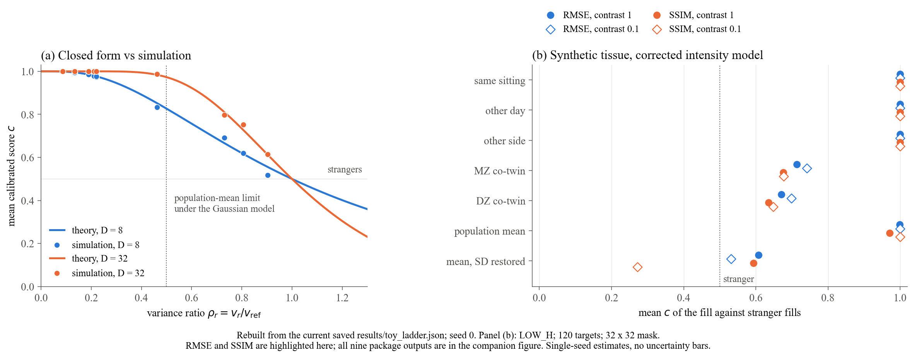

(a) Closed form $E\,c = P(F_{D,D} > \rho)$ against simulation, $D = 8$ and $32$. (b) Synthetic 2D tissue, genetic share 0.19,
ho)$ against simulation, D = 8 and 32. (b) Synthetic 2D tissue, genetic share 0.19,
32 x 32 mask, RMSE and SSIM from the official BraTS code; filled marks contrast 1, open marks contrast 0.1.

## Step-by-step shrinkage to the mean (`src/rebuild_visuals.py`)

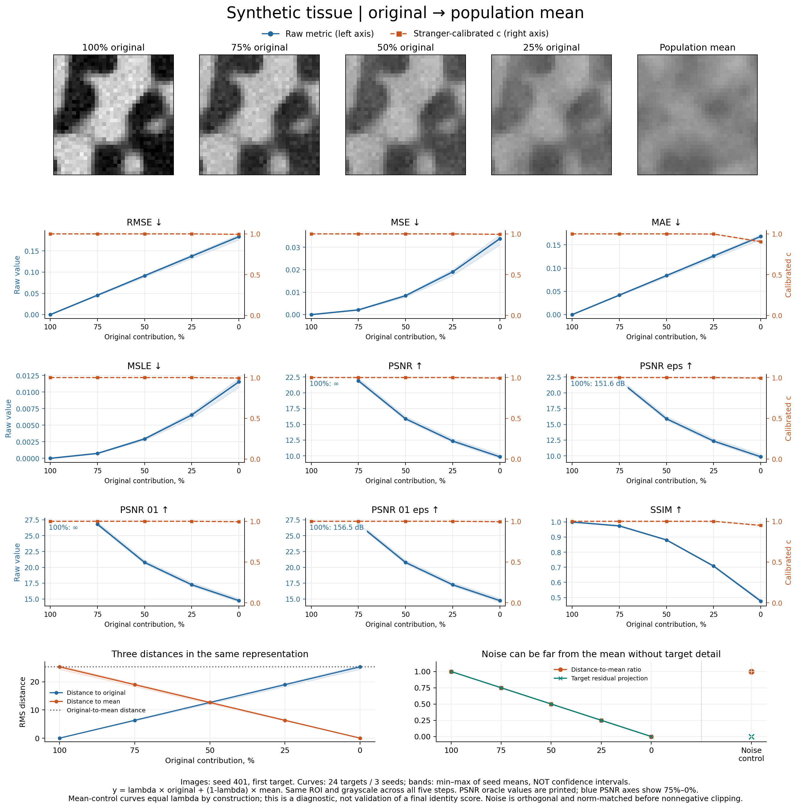

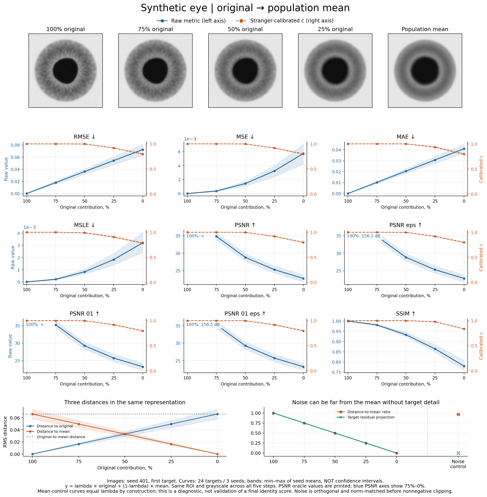

## Population null, all metrics (`src/detail_report.py summary`)

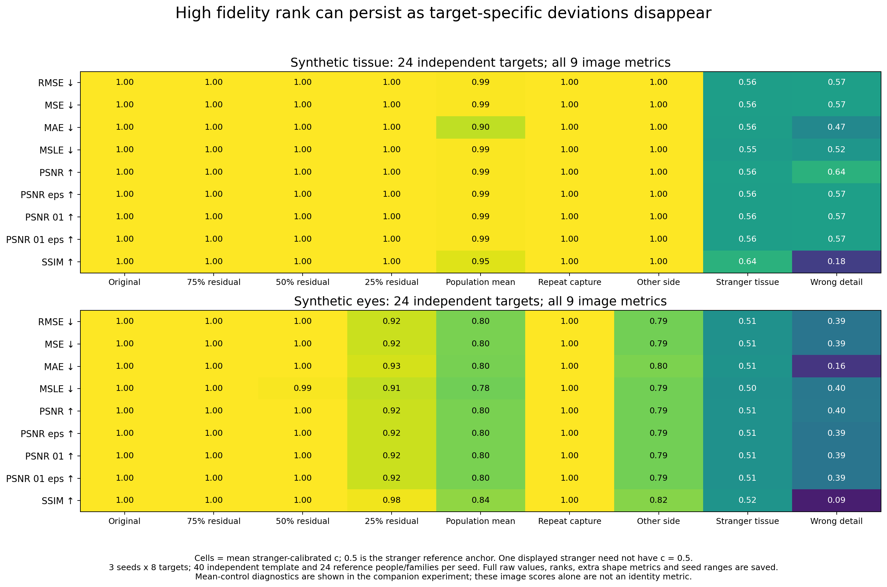

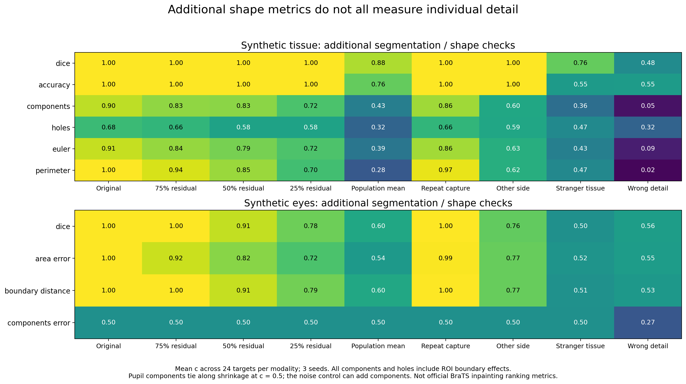

## All BraTS metrics on the synthetic ladder (`src/ladder_report.py`)

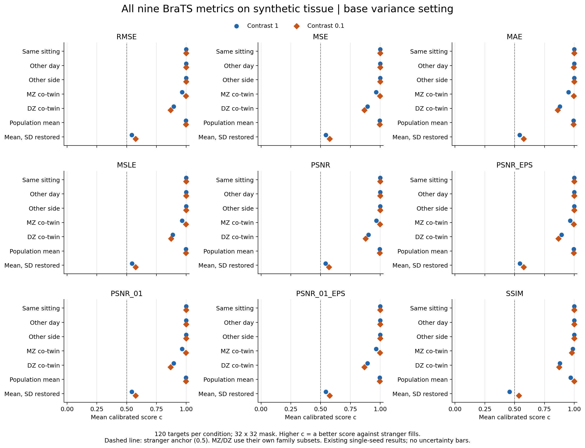

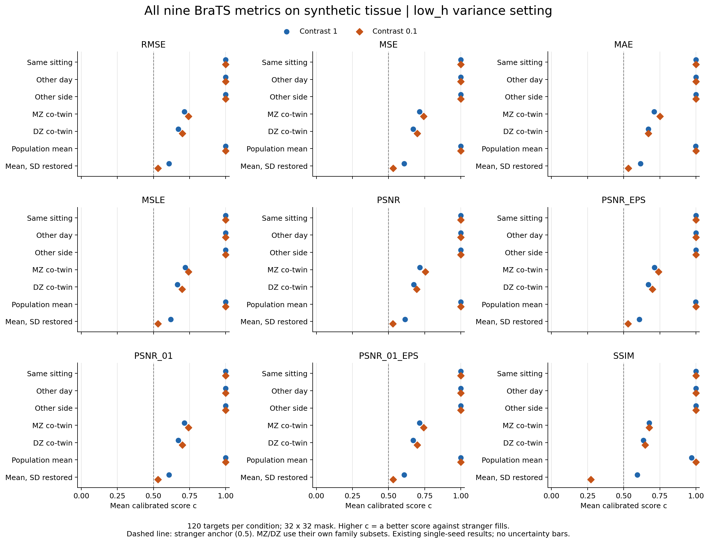

## H19 robustness (`src/ladder_report.py`)

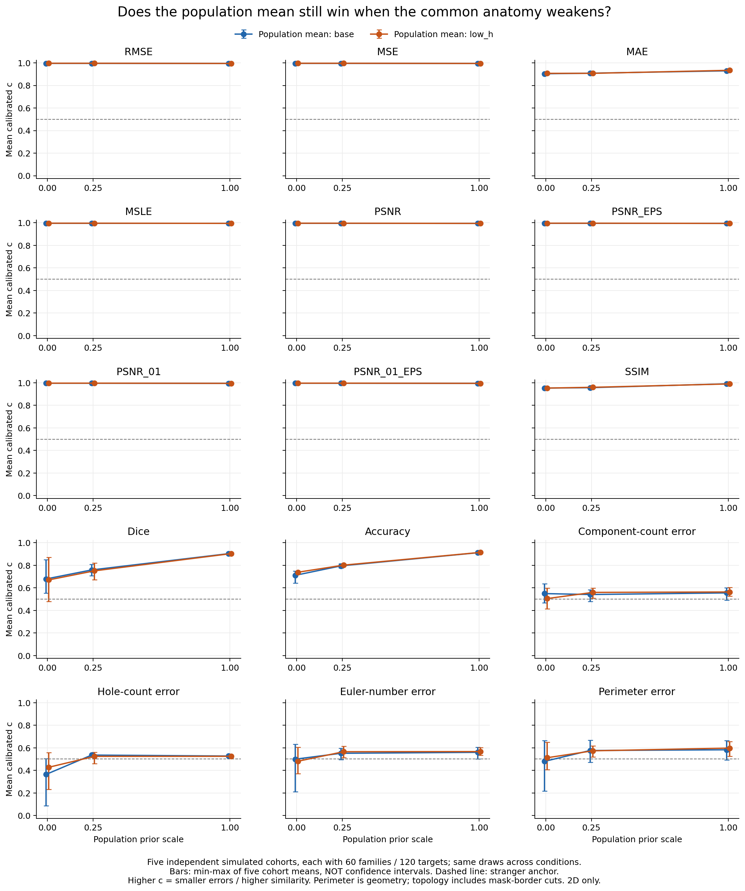

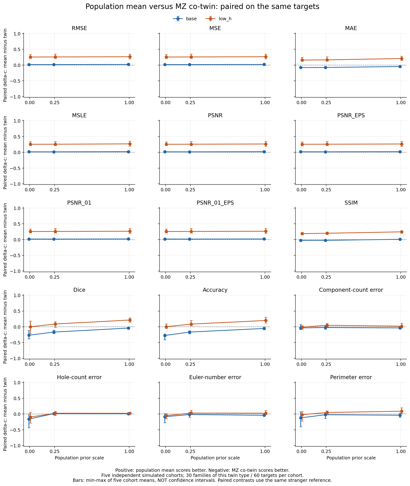

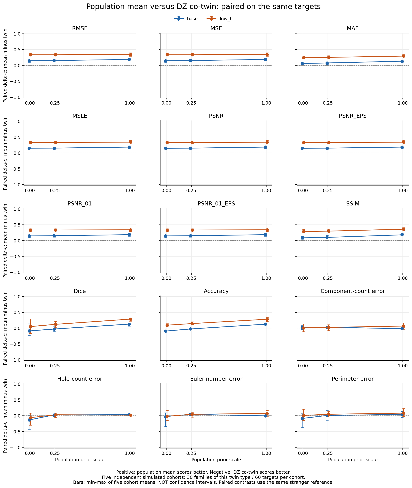

## Pupil experiment, all metrics (`src/pupil_report.py`)

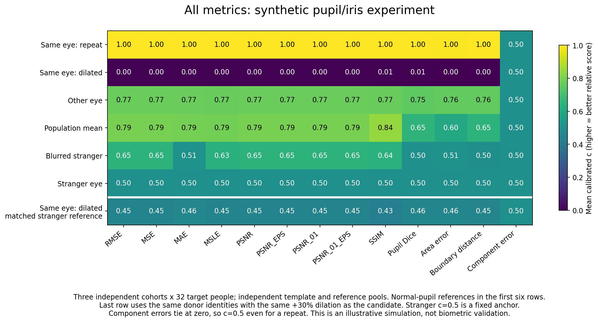
